# Home Lab SIEM and Detection Engineering

A small SOC built at home. I set up a Wazuh SIEM, ran simulated attacks on a Windows machine with Atomic Red Team, checked what Wazuh caught, and wrote my own detection rules for the attacks it missed. Every rule is mapped to MITRE ATT&CK.

## What I built

| Machine | Role | Details |
|---|---|---|
| wazuh-server | SIEM | Ubuntu Server 22.04 VM, Wazuh 4.14 (server, indexer and dashboard) |
| win-endpoint | Monitored Windows machine | Windows 11 Enterprise evaluation VM with the Wazuh agent and Sysmon |

Both VMs run in VMware Workstation on a private NAT network, so nothing in the lab is exposed to the internet.

**How the data flows**

```
Windows activity -> Sysmon + Windows logs -> Wazuh agent -> Wazuh server (rules) -> alerts on the dashboard
```

Sysmon (SwiftOnSecurity config) records detailed process, registry and network activity. The Wazuh agent reads the Sysmon log channel and sends it to the server, which compares each event against its rules.

## Attacks tested

I used Atomic Red Team to run one test per technique, then searched the Wazuh dashboard to see what fired.

| Technique | Test | Wazuh default result | My result |
|---|---|---|---|
| T1053.005 Scheduled Task | schtasks /create | Level 3 generic alert, wrongly tagged T1087 and T1059.003 | Custom rule 100100 (level 10) |
| T1547.001 Registry Run Keys | reg.exe Run key | Rule 92302, level 6 | Detected by default |
| T1136.001 Create Local Account | net user /add | Rule 92040, level 12 | Detected by default |
| T1105 Ingress Tool Transfer | certutil -urlcache | Generic alerts only | Custom rule 100101 (level 10) |
| T1218.010 Regsvr32 | regsvr32 scriptlet | Generic alerts only | Custom rule 100102 (level 10) |
| T1564.001 Hidden Files | attrib +h | Generic alerts only | Custom rule 100103 (level 8) |
| T1003.001 LSASS Dump | comsvcs.dll | n/a | Blocked by Windows before it ran |

## Custom rules

All rules are in [`local_rules.xml`](local_rules.xml). Each one matches a Sysmon process-creation event, checks the original file name and the command line, and adds the right MITRE ATT&CK ID.

Example, scheduled task persistence:

```xml
<rule id="100100" level="10">
  <if_sid>61603,92032</if_sid>
  <field name="win.eventdata.originalFileName" type="pcre2">(?i)^schtasks\.exe$</field>
  <field name="win.eventdata.commandLine" type="pcre2">(?i)\s/create\b</field>
  <description>Scheduled task created with schtasks.exe on $(win.system.computer): possible persistence</description>
  <mitre>
    <id>T1053.005</id>
  </mitre>
</rule>
```

Matching on `originalFileName` means the rule still fires if an attacker renames the executable.

## Evidence

**Before and after, scheduled task**

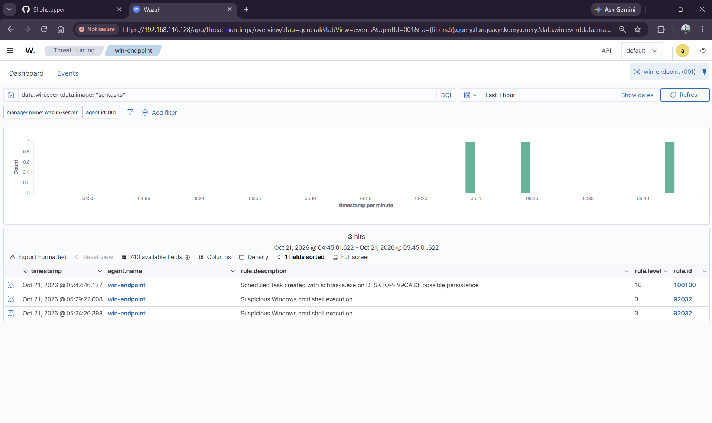
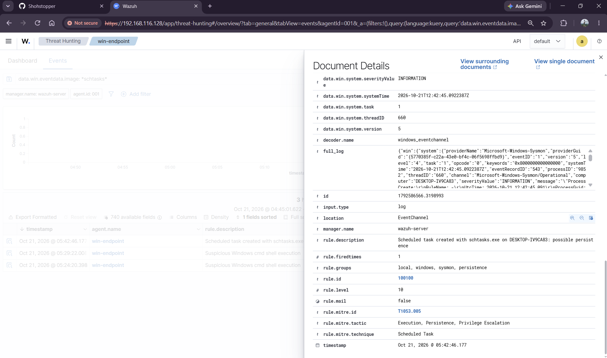
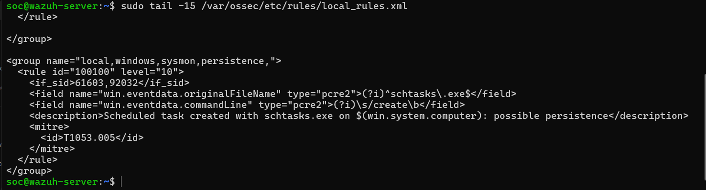

**Techniques Wazuh already detected**

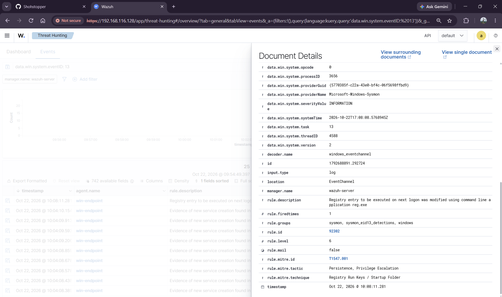
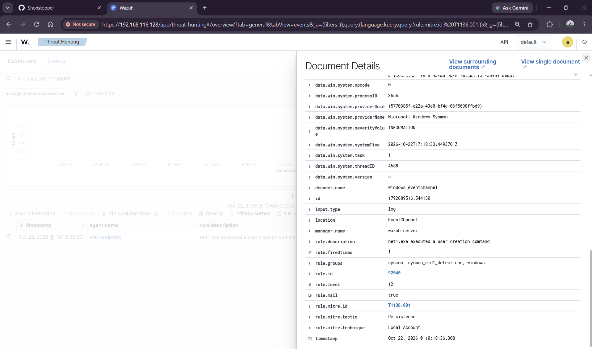

**Gaps before my rules (only generic alerts)**

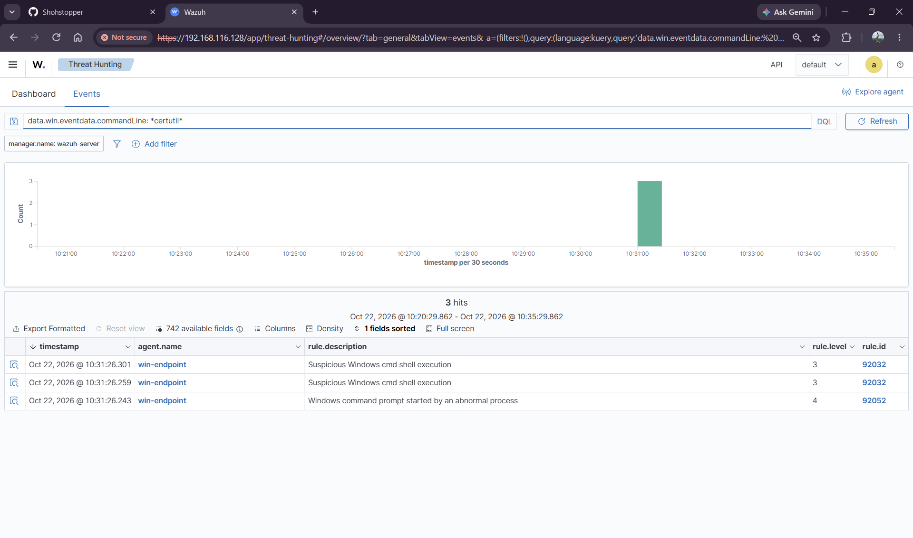
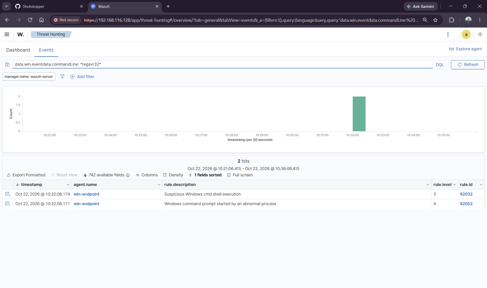
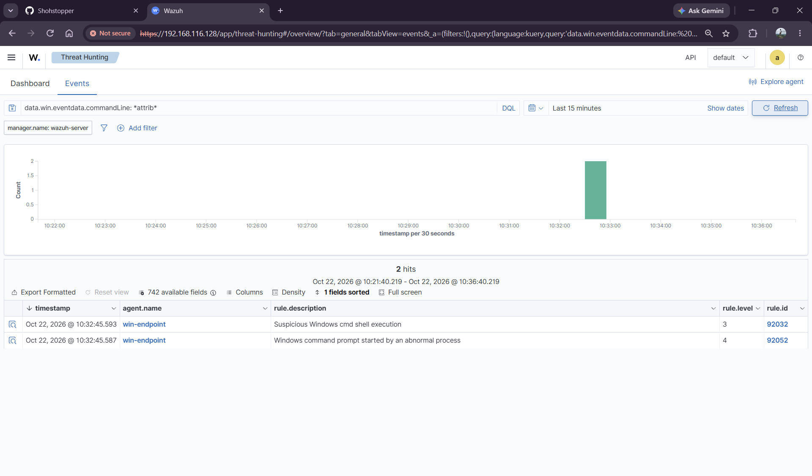

**All custom rules firing**

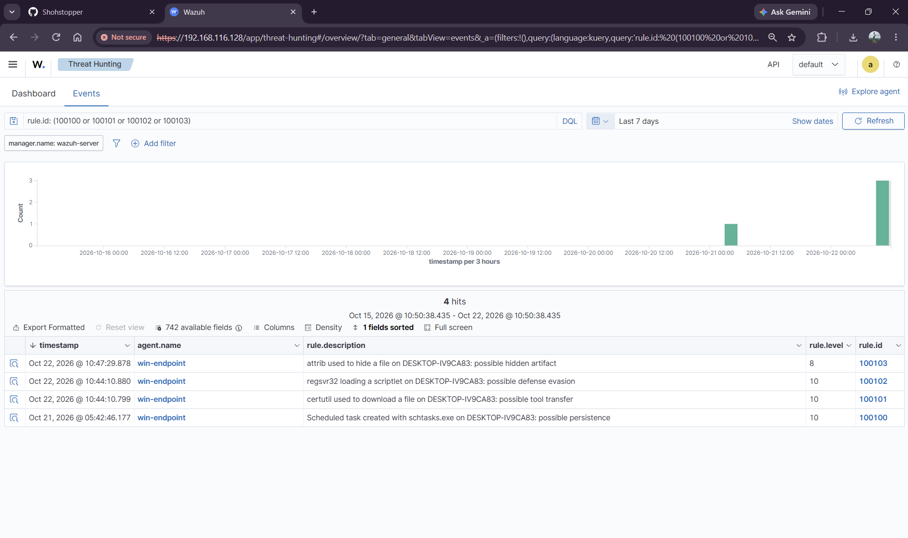

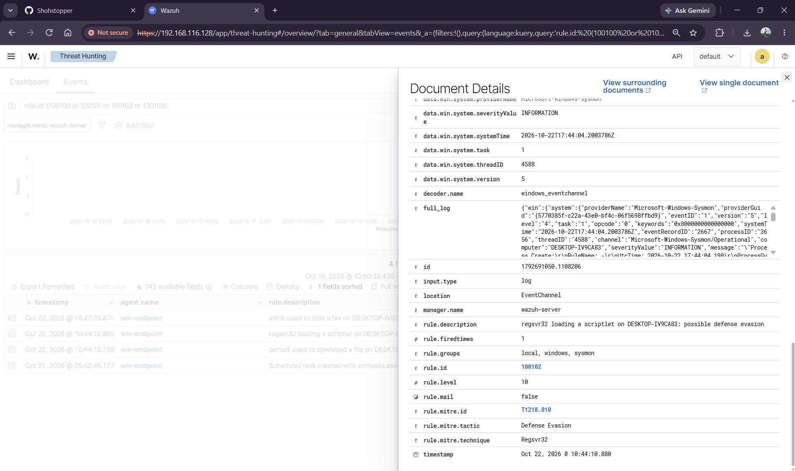
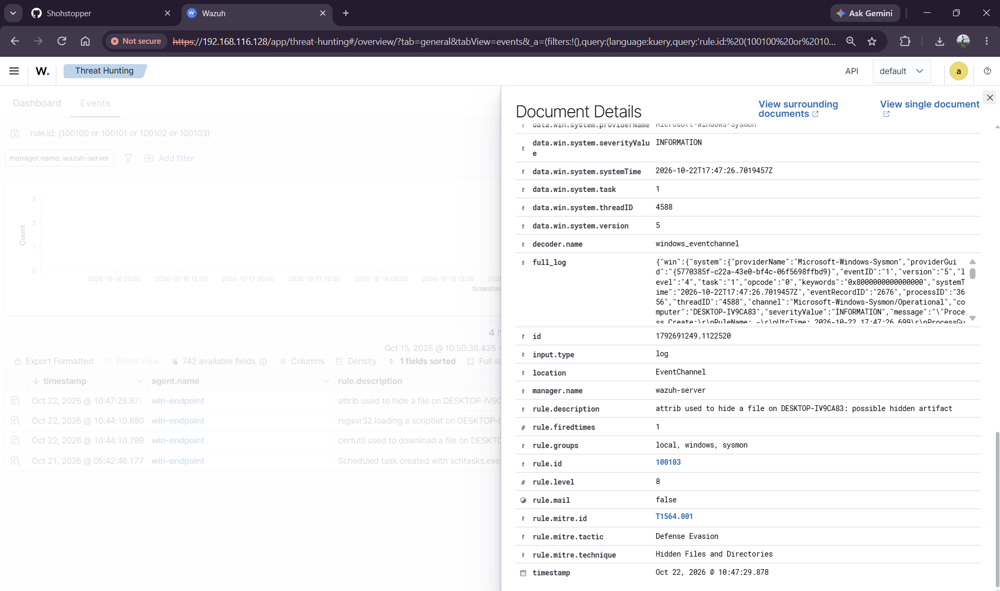

## How to reproduce

1. Install VMware Workstation and create two VMs (Ubuntu Server 22.04, Windows 11 Enterprise evaluation).
2. Install Wazuh on the Ubuntu VM with the all-in-one installer from the Wazuh quickstart.
3. Install the Wazuh agent on Windows using the dashboard's Deploy new agent command.
4. Install Sysmon with the SwiftOnSecurity config, then add this block to the agent's `ossec.conf` and restart the agent:
```xml
   <localfile>
     <location>Microsoft-Windows-Sysmon/Operational</location>
     <log_format>eventchannel</log_format>
   </localfile>
```
5. Install Invoke-AtomicRedTeam on the Windows VM. Windows Defender blocks the tests, so I turned its real-time protection off in this throwaway lab VM only.
6. Add `local_rules.xml` to `/var/ossec/etc/rules/` on the server, run `/var/ossec/bin/wazuh-analysisd -t`, and restart `wazuh-manager`.
7. Run a test, for example `Invoke-AtomicTest T1053.005 -TestNumbers 2`, and search `rule.id: 100100` in Threat Hunting.

## What I learned

- Wazuh's default rules cover some persistence and account creation well, but miss several living-off-the-land techniques like certutil downloads and regsvr32 scriptlets.
- Several default alerts are mislabelled. The scheduled task attack was tagged as account discovery.
- Windows Defender stopped the LSASS dump test, which is a good result for a real endpoint but left nothing to detect in this lab.

## Limitations and next steps

- One Windows endpoint and one test per technique, so false positive rates are not measured. Admins use certutil and attrib legitimately, so these rules would need tuning in a real environment.
- Rules match on command-line patterns, which a determined attacker can obfuscate.
- Next: tune the rules against normal activity, add a Linux endpoint, and feed the alerts into an AI triage agent.
